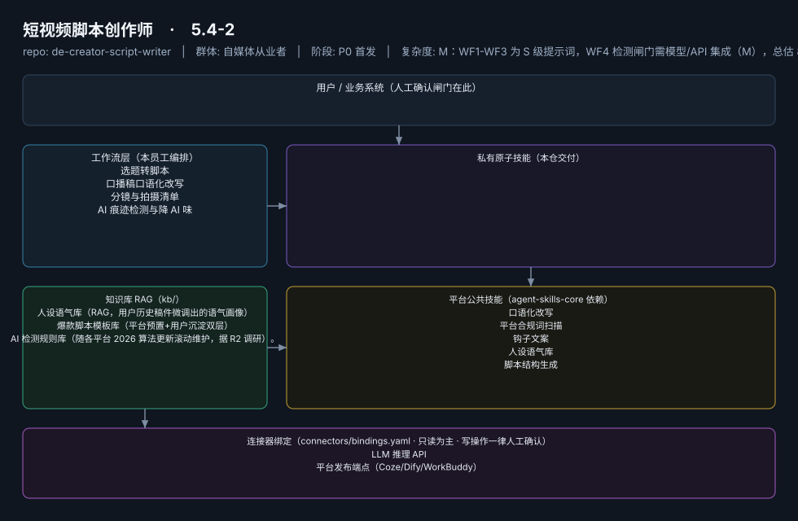

# 短视频脚本创作师

> 从选题到过检成稿的脚本流水线，写得快且不被限流
>
> **5.4-2**　·　自媒体从业者　·　阶段 P0 首发　·　
> 复杂度 M：WF1-WF3 为 S 级提示词，WF4 检测闸门需模型/API 集成（M），总估 8-10 人日　·　¥30-80/月（据 R2 调研）　·　定义卡 5.4-2



**一句话**：短视频/直播创作者（亿级账号池），日更/隔日更口播类作者

---

## 这个数字员工解决什么问题

从选题到过检成稿的脚本流水线，写得快且不被限流

| 项 | 内容 |
|---|---|
| 服务对象 | 短视频/直播创作者（亿级账号池），日更/隔日更口播类作者 |
| 可量化目标 | 单脚本产出时长 ≤15 分钟（原 3-6h 创作环节中的写作段）；AI 检测通过率 ≥90%；成片采用率 ≥60% |
| 投入产出 | 日更场景月省约 70h，折 ¥1700-2800，ROI >20 倍 |
| 需求依据 | D01、D26 |
| 分发渠道 | GitHub（必备基础渠道）、抖音、小红书、Coze扣子商店、豆包工作、腾讯WorkBuddy Skill市场 |

## 30 秒上手

```bash
git clone <本仓库地址> && cd de-creator-script-writer
pip install pyyaml
python3 tests/run.py            # 先跑一遍自检，确认环境与契约都对得上
```

试用（把 `<输入>` 换成本人真实材料）：

```text
请以「短视频脚本创作师」的身份，帮我跑「选题转脚本」。
材料如下：<输入>
要求：只使用材料里出现过的数字，缺的写 <待填>；对外文案停在待确认状态。
```

详细接入见 [`docs/01-安装与接入.md`](docs/01-安装与接入.md)。

## 仓库结构

```text
de-creator-script-writer/
├── employee.yaml          # 机器契约（能力清单 + 依赖锁）
├── dependencies.yaml      # 对 core 的外部依赖（含版本）
├── persona/               # 运行提示词 / 边界 / KPI
├── skills/                # 私有原子技能（0 个）
├── spec-bindings/         # 有意不公共化能力的本地绑定声明（0 个）
├── workflows/             # 本员工工作流（4 条）
├── kb/                    # 知识库 RAG 契约
├── connectors/            # 连接器绑定（只读为主，写操作人工确认）
├── docs/                  # 六类发布文档
└── tests/                 # 自动化多场景测试
```

## 私有原子技能（0）

（无）

## 平台公共技能依赖（5）

| 技能 | slug | 全平台复用员工数 |
|---|---|---|
| `口语化改写` | `colloquial-rewrite` | 2 |
| `平台合规词扫描` | `compliance-word-scan` | 6 |
| `钩子文案` | `hook-copy` | 2 |
| `人设语气库` | `persona-tone-lib` | 2 |
| `脚本结构生成` | `script-structure` | 3 |

> 这些技能来自 `agent-skills-core@1.0.0`，本仓库**只引用不复制**。

## Spec 绑定层（0）

（无）

> 这一族能力**有意不公共化**（与外部平台接口强绑定）。本仓不存正文，
> 只留本地绑定声明与连接器配置。

## 工作流（4）

| 工作流 | slug | 触发 | 阶段 | 调用技能数 |
|---|---|---|---|---|
| `选题转脚本` | `wf-creator-script-topic-to-script` | 人工（选题确认后） | P0 | 2 |
| `口播稿口语化改写` | `wf-creator-script-colloquial` | 事件（WF1 后自动） | P0 | 2 |
| `分镜与拍摄清单` | `wf-creator-script-storyboard` | 人工（按需） | P1 | 1 |
| `AI 痕迹检测与降 AI 味` | `wf-creator-script-ai-gate` | 事件（交付前强制闸门） | P0 | 2 |

## 知识库与连接器

- 知识库语料：['人设语气库（RAG，用户历史稿件微调出的语气画像）', '爆款脚本模板库（平台预置+用户沉淀双层）', 'AI 检测规则库（随各平台 2026 算法更新滚动维护，据 R2 调研）。']
- 连接器：LLM 推理 API、平台发布端点（Coze/Dify/WorkBuddy）

## 质量与验收

| 项 | 值 |
|---|---|
| 技能文件数 | 79 |
| 多场景用例数 | 147 |
| 用例通过 | 147 |
| 验收结论 | ✅ 通过 |

完整报告：[`docs/05-验收与测试.md`](docs/05-验收与测试.md)

## 许可

专有许可，详见 [`LICENSE`](LICENSE)。
